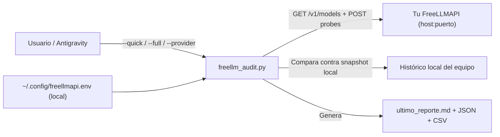

# FreeLLMAPI Audit (`freellmapi-audit`)

[](https://www.python.org/)
[](#requisitos)
[](#instalaci%C3%B3n)
[](#uso-desde-antigravity)
[](./LICENSE)

Herramienta **on-demand** y bundle oficial (Plugin + Skill de Antigravity) para auditar cualquier instancia de [FreeLLMAPI](https://github.com/tashfeenahmed/freellmapi): detecta modelos nuevos, caídos o retirados mediante **diff local por equipo**, monitoriza tus cadenas VIP (`auto:*`) y verifica en segundos la salud de los **8 módulos / 16 pruebas de endpoints** (`/v1/chat/completions`, `/v1/responses`, `/v1/messages`, `/v1/embeddings`, `/v1/decisions`, `/v1/search`, `fusion`, `/v1/audio/*`, `/v1/images/generations` y `/v1/videos/generations`).

---

## Tabla de contenidos

- [Principios y responsabilidad de uso](#principios-y-responsabilidad-de-uso)
- [Cómo funciona](#c%C3%B3mo-funciona)
- [Requisitos](#requisitos)
- [Instalación](#instalaci%C3%B3n)
- [Configuración local por equipo](#configuraci%C3%B3n-local-por-equipo)
- [Modos y opciones CLI](#modos-y-opciones-cli)
- [Módulos y endpoints verificados](#m%C3%B3dulos-y-endpoints-verificados)
- [Diagnóstico automático de fallos](#diagn%C3%B3stico-autom%C3%A1tico-de-fallos)
- [Personalizar cadenas VIP por equipo](#personalizar-cadenas-vip-por-equipo)
- [Uso desde Antigravity](#uso-desde-antigravity)
- [Solución de problemas](#soluci%C3%B3n-de-problemas)
- [Documentación adicional y licencia](#documentaci%C3%B3n-adicional-y-licencia)

---

## Principios y responsabilidad de uso

1. **Servicio propio por usuario:** este repositorio **no incluye** servidores, hosts ni API keys. Quien instale y utilice la skill/plugin es responsable de habilitar su propia instancia de FreeLLMAPI y configurar su dirección, puerto y API key local.
2. **Histórico estrictamente local por equipo:** las corridas, métricas y reportes (`ultimo_catalogo.json`, `estado_acumulado.json`, `ultimo_reporte.md`) se almacenan por máquina en rutas locales del sistema operativo (nunca en carpetas compartidas ni sincronizadas entre equipos).
3. **100% multiplataforma y cero dependencias externas:** funciona nativamente en Windows, macOS, Linux y WSL usando únicamente la librería estándar de Python 3.

---

## Cómo funciona



---

## Requisitos

- **Python 3.9 o superior** (cero `pip install`, sin entornos virtuales obligatorios).
- Una instancia operativa de **FreeLLMAPI** accesible desde el equipo (por ejemplo `http://localhost:3001` o una IP/host de tu red local) y su **API key unificada**.

---

## Instalación

### Opción 1: Clonar desde GitHub e instalar en 1 comando (recomendada)

**Linux / macOS / WSL:**
```bash
git clone https://github.com/fernandovd10-code/freellmapi-audit.git
cd freellmapi-audit
python3 install.py --mode plugin --init
```

**Windows (PowerShell o CMD):**
```powershell
git clone https://github.com/fernandovd10-code/freellmapi-audit.git
cd freellmapi-audit
python install.py --mode plugin --init
```

### Opción 2: Descargar release comprimido

1. Descarga `freellmapi-audit-v1.0.0.zip` (Windows) o `freellmapi-audit-v1.0.0.tar.gz` (Linux/macOS) desde la sección **[Releases](https://github.com/fernandovd10-code/freellmapi-audit/releases)**.
2. Descomprime y ejecuta dentro de la carpeta extraída:
   ```bash
   python3 install.py --mode plugin --init   # Windows: python install.py --mode plugin --init
   ```

### Opciones de `install.py`

| Flag | Descripción |
|---|---|
| `--mode plugin` *(por defecto)* | Instala el bundle completo (`plugin.json` + skill) en `~/.gemini/config/plugins/freellmapi-audit` (o `%USERPROFILE%\.gemini\config\plugins\freellmapi-audit`). |
| `--mode skill` | Instala únicamente la skill suelta en `~/.gemini/config/skills/freellmapi-audit`. |
| `--workspace <ruta>` | Instala a nivel de proyecto dentro de `<ruta>/.agents/plugins/` o `<ruta>/.agents/skills/`. |
| `--target <ruta>` | Ruta exacta de instalación personalizada. |
| `--init` | Ejecuta el asistente interactivo de configuración local tras copiar los archivos. |

---

## Configuración local por equipo

Cada máquina mantiene su propia configuración y su propio histórico.

### 1. Asistente interactivo (`--init`) y verificación (`--check-config`)

```bash
# Configurar URL (o host + puerto) y API key guardando en archivo local .env
python3 ~/.gemini/config/plugins/freellmapi-audit/skills/freellmapi-audit/scripts/freellm_audit.py --init

# Verificar qué configuración, endpoint, clave enmascarada e histórico detecta este equipo
python3 ~/.gemini/config/plugins/freellmapi-audit/skills/freellmapi-audit/scripts/freellm_audit.py --check-config
```

> **Windows:** sustituye `python3` por `python` (o `py -3`) y `~/.gemini/...` por `%USERPROFILE%\.gemini\...`.

### 2. Prioridad de configuración

El script resuelve la configuración en este orden (de mayor a menor prioridad):

1. **Flags CLI:** `--base`, `--key`, `--data-dir`, `--vip-file`, `--env-file`
2. **Variables de entorno:** `FREELLM_BASE` (o `FREELLM_HOST` + `FREELLM_PORT`), `FREELLM_KEY`, `FREELLM_DATA_DIR`, `FREELLM_ENV_FILE`
3. **Archivo `.env` local:**
   - **Linux / macOS / WSL:** `~/.config/freellmapi.env` (creado con permisos `600` por `--init`)
   - **Windows:** `%USERPROFILE%\.config\freellmapi.env` (con respaldo de lectura en `%APPDATA%\freellmapi\freellmapi.env`)

Puedes usar [.env.example](./.env.example) como plantilla manual:
```bash
FREELLM_BASE=http://localhost:3001
# O bien por separado:
# FREELLM_HOST=192.168.1.50
# FREELLM_PORT=3001
FREELLM_KEY=freellmapi-reemplaza-con-tu-clave
```
*(No importa si escribes `/v1` al final o si omites `http://`: `freellm_audit.py` normaliza la URL automáticamente.)*

### 3. Ubicación del histórico local (por defecto)

| Sistema operativo | Directorio local asignado |
|---|---|
| **Windows** | `%LOCALAPPDATA%\freellmapi-audit\history` |
| **macOS** | `~/Library/Application Support/freellmapi-audit/history` |
| **Linux / WSL** | `~/.local/state/freellmapi-audit/history` *(o `$XDG_STATE_HOME/freellmapi-audit/history`)* |

---

## Modos y opciones CLI

| Comando | Qué hace | Uso típico |
|---|---|---|
| `--quick` *(default)* | Detecta modelos nuevos en `/v1/models`, prueba tus cadenas VIP + modelos nuevos + `auto` + todos los módulos. | Chequeo diario (~45–60 s) sin quemar cuotas |
| `--full` | Barre **todos** los modelos `available: true` del catálogo + todos los módulos. | Auditoría semanal o tras cambios grandes (~5–6 min) |
| `--provider <p1,p2>` | Re-prueba solo los modelos previamente registrados bajo esos proveedores (p. ej. `custom,waterfall`). | Justo después de renovar API keys caídas |
| `--filter <s1,s2>` | Prueba solo modelos cuyo ID contenga alguna de esas subcadenas (p. ej. `gemini,qwen`). | Validar una familia concreta |
| `--modules-only` | Omite el barrido de modelos de chat y solo ejecuta los 16 pings de módulos. | Comprobar embeddings, audio, imagen, search, etc. |
| `--seed-from <archivo.json>` | Importa un barrido completo previo como línea base en `estado_acumulado.json`. | Migrar de un JSON previo |

### Flags adicionales

- `--modules`: fuerza la ejecución de los pings de módulo cuando usas `--provider` o `--filter`.
- `--no-modules`: omite la suite de módulos en `--quick` o `--full`.
- `--no-media`: omite Imagen y Audio TTS/STT durante el ping de módulos.
- `--live-video`: envía un prompt real a `/v1/videos/generations` (por defecto solo valida el esquema sin consumir cuota).
- `--include-unavailable`: incluye modelos marcados como `disabled` o `no_key` en `--full` o `--filter`.
- `--workers 6` · `--timeout 25` · `--retries 1` · `--max-wait 12` · `--limit 0`: ajuste fino de concurrencia y tiempos de espera.

---

## Módulos y endpoints verificados

En `--quick`, `--full` y `--modules-only` se ejecutan **16 pruebas** sobre las 8 áreas de FreeLLMAPI:

| Área / Pestaña | Pruebas ejecutadas | Qué valida |
|---|---|---|
| **Chat / APIs** | `chat_auto_fast`, `chat_auto_smart`, `responses`, `messages_anthropic`, `messages_count_tokens` | Enrutamiento `auto:*`, formato OpenAI Responses, compatibilidad Anthropic (`x-api-key`) y conteo de tokens |
| **Embeddings** | `embeddings_auto`, `embeddings_bge_m3`, `embeddings_codestral` | Respuesta vectorial real, proveedor asignado y número de dimensiones sin mezclar familias |
| **Decisión** | `decisions_choice`, `decisions_noul` | Clasificación multiclase con confianza y predicado booleano `noul` |
| **Search** | `search` | Búsqueda web en vivo con failover de motores (`/v1/search`) |
| **Fusión** | `fusion_fast` | Panel múltiple (`k: 2`, `strategy: "best_of"`, `expose_panel: true`) y campo `x_fusion` |
| **Audio** | `audio_tts`, `audio_stt` | Síntesis de voz (MP3/WAV) y transcripción de audio WAV sintetizado en memoria |
| **Imagen** | `imagen` | Generación texto-a-imagen (`b64_json` o `url`) en `/v1/images/generations` |
| **Video** | `video` | Validación de ruta/esquema (`ok_esquema` sin gastar créditos) o generación real con `--live-video` |

---

## Diagnóstico automático de fallos

Cada modelo fallido se clasifica en una causa accionable:

| Etiqueta | Significado | Acción sugerida |
|---|---|---|
| `api_key_invalida` | HTTP `401`/`403` o error de autenticación upstream | Renueva o desactiva la clave de ese proveedor en el panel de FreeLLMAPI |
| `sin_credito` | HTTP `402` / `out_of_credits` / saldo agotado | Desactiva ese modelo en ese proveedor o recarga cuota |
| `modelo_retirado` | HTTP `404`/`410` / modelo eliminado en origen | Deshabilita el modelo en el panel (catálogo obsoleto) |
| `rate_limit` | HTTP `429` o modelo en cooldown / `exhausted` | Espera el reset o añade claves adicionales del proveedor |
| `error_proveedor` | HTTP `5xx` o fallo temporal upstream | Error del proveedor externo; reintenta más tarde |
| `sin_capacidad` | El modelo asignado carece de la capacidad pedida (ej. visión) | Saca ese modelo de cadenas especializadas (`auto:vision`) |
| `timeout` / `conexion` | Excedió `--timeout` o fallo de red local | Revisa latencia del proveedor o conectividad al puerto del gateway |

---

## Personalizar cadenas VIP por equipo

El paquete incluye cadenas curadas base en [`skills/freellmapi-audit/resources/vip_chains.json`](./skills/freellmapi-audit/resources/vip_chains.json) (`rapido`, `codigo`, `inteligente`, `largo`, `vision`).

Para personalizarlas **solo en un equipo** sin que futuras actualizaciones del plugin sobrescriban tus cambios:
1. Copia `vip_chains.json` dentro de tu carpeta local de histórico (`<FREELLM_DATA_DIR>/vip_chains.json`).
2. Edita sus listas de modelos; `freellm_audit.py` detecta y prioriza automáticamente ese archivo local.

---

## Uso desde Antigravity

Una vez instalado con `install.py` y configurado tu `.env` local, Antigravity activa la skill automáticamente en cualquier workspace cuando pidas cosas como:

- *"Audita mi FreeLLMAPI hoy y dime qué modelos nuevos entraron o cayeron"*
- *"Haz un barrido completo de todos los modelos en mi FreeLLMAPI"*
- *"Ya actualicé la clave de custom en el panel, revalídala"*
- *"Comprueba si funcionan embeddings, decisions, search, audio, imagen y video"*

Si aún no configuraste el equipo, el agente ejecutará `--check-config` primero y te guiará para definir la dirección, puerto y API key de tu instancia.

---

## Solución de problemas

- **`Error consultando /v1/models` o timeout de red:** verifica que tu servicio FreeLLMAPI esté ejecutándose en la URL/puerto indicado y que el firewall de la máquina anfitriona permita el puerto (habitualmente `3001`). Si estás dentro de un entorno sandbox de agente, permite el acceso de red local (`BypassSandbox: true`).
- **`Falta API key de FreeLLMAPI` (código de salida 2):** ejecuta `python3 .../freellm_audit.py --init` o revisa que exista `~/.config/freellmapi.env` (o `%USERPROFILE%\.config\freellmapi.env` en Windows).
- **Aviso de `hostname` distinto en el histórico:** configuraste `FREELLM_DATA_DIR` apuntando a una carpeta compartida entre equipos. Cambia `FREELLM_DATA_DIR` a una ruta local o déjalo sin definir para usar el directorio local por defecto del sistema operativo.

---

## Documentación adicional y licencia

- **[Arquitectura técnica detallada](./docs/ARCHITECTURE.md)**
- **[Historial de cambios](./CHANGELOG.md)**
- **[Licencia MIT](./LICENSE)**
